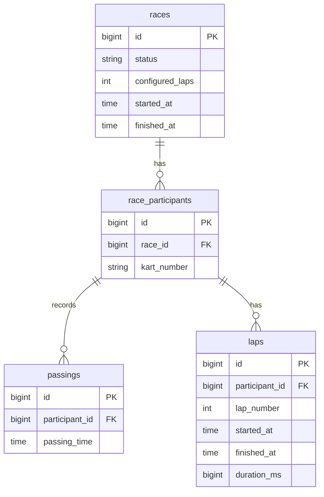

# Kart Timing API

Spring Boot REST API for a small karting track timing system.

A race has up to five karts and a fixed lap count. Each time a kart crosses start/finish, a **passing** is recorded. The race ends when any kart completes all laps. The **winner** is the driver with the **fastest lap** (not who finishes first).

## Stack

- Java 21, Spring Boot 4, Spring Web, Spring Data JPA, Spring Security (JWT)
- PostgreSQL 16
- springdoc OpenAPI / Swagger UI
- JUnit 5 (+ H2 for tests)

## Assumptions

1. There can only be up to 5 unique kart numbers (string, alphanumeric allowed, e.g. `"5"` or `"A12"`), and minimum 1 kart registered when the race starts.
2. The race starts at first crossing per kart, not when a lap is completed.
3. Edge case handling for when the clock strikes 00:00 - if lap finish time is before start time, duration adds 24 hours (`23:59:35` → `00:00:25` = 50s).
4. Only one `STARTED` race at a time.
5. Each crossing that starts a lap creates a pending lap, and the next crossing closes it.Once the race is `FINISHED`, passing is only accepted if that kart still has a pending lap. The winner uses completed laps.
6. Tie-break for fastest lap: shorter duration, then earlier lap start time.
7. CSV is ingested **top-to-bottom**, and it must already be chronological.
 

## Quick start (Docker)

```bash
docker compose up -d postgres
./mvnw spring-boot:run
```

Postgres is published on host port **5434**. Swagger UI: [http://localhost:8080/swagger-ui.html](http://localhost:8080/swagger-ui.html)

Or run app + DB together:

```bash
docker compose up --build
```

### Without Docker

1. Create a database and user in your local Postgres:

```sql
CREATE USER kart WITH PASSWORD 'kart';
CREATE DATABASE karttiming OWNER kart;
```

2. Point `src/main/resources/application.yml` at that instance (default below assumes port **5432**):

```yaml
spring:
  datasource:
    url: jdbc:postgresql://localhost:5432/karttiming
    username: kart
    password: kart
```

3. Start the app:

```bash
./mvnw spring-boot:run
```

Hibernate `ddl-auto: update` creates/updates tables on startup.

## Demo user

For simplicity's sake, there is **no registration** for now. A single admin user is defined in `application.yml` (BCrypt password hash + role). Every login issues a JWT for write operations.

| Username | Password   | Role |
|----------|------------|------|
| `admin`  | `admin123` | ADMIN - start race, record passings, import, finish |

All read endpoints (race details / winner) are **public** - no token required.

## Sample flow (CSV)

Expected winner from `src/main/resources/sample/karttimes.csv` with 4 laps:

- **Kart 5**, lap **4**, **56s**, started **12:03:37**
- Race auto-finishes when kart 2 completes lap 4 at `12:04:20`; but kart 5’s in-progress lap still counts.

```bash
# Login
TOKEN=$(curl -s -X POST http://localhost:8080/api/auth/login \
  -H 'Content-Type: application/json' \
  -d '{"username":"admin","password":"admin123"}' | jq -r .accessToken)

# Start race
RACE_ID=$(curl -s -X POST http://localhost:8080/api/races \
  -H "Authorization: Bearer $TOKEN" \
  -H 'Content-Type: application/json' \
  -d '{"lapCount":4,"kartNumbers":["1","2","3","4","5"]}' | jq -r .id)

# Import sample CSV
curl -s -X POST "http://localhost:8080/api/races/$RACE_ID/import" \
  -H "Authorization: Bearer $TOKEN" \
  -F "file=@src/main/resources/sample/karttimes.csv"

# Winner (public)
curl -s "http://localhost:8080/api/races/latest/winner"
```

## Main endpoints

| Method | Path | Auth | Description |
|--------|------|------|-------------|
| POST | `/api/auth/login` | public | JWT |
| POST | `/api/races` | ADMIN | Start race |
| POST | `/api/races/{id}/passings` | ADMIN | Record passing |
| POST | `/api/races/{id}/import` | ADMIN | Import CSV |
| POST | `/api/races/{id}/finish` | ADMIN | Manual finish |
| GET | `/api/races/{id}` | public | Race + laps |
| GET | `/api/races/{id}/winner` | public | Winner |
| GET | `/api/races/latest/winner` | public | Latest winner |

## Data model

- **races** - race config / status
- **race_participants** - kart id per race
- **passings** - raw timing events linked to a participant (source of truth)
- **laps** - per participant; pending until the next crossing

### ER diagram




## Logging

- Each request gets an `X-Request-Id` (generated or taken from the incoming header) and is included on the response.
- Logs include that id via MDC and the request duration, e.g. `POST /api/races -> 201 (12 ms)`.
- Domain events (race start/finish, CSV import) are logged at `INFO`.

## Tests

```bash
./mvnw test
```

